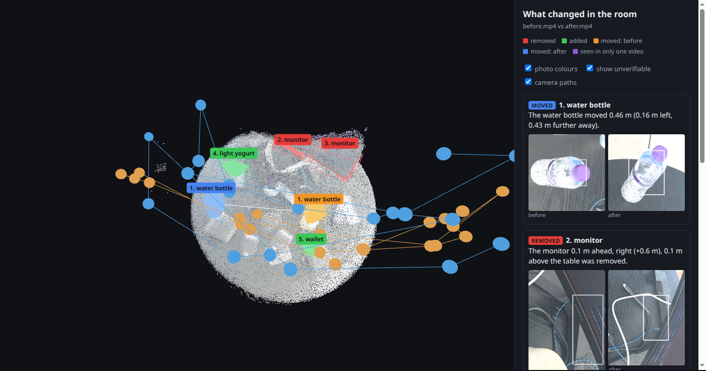
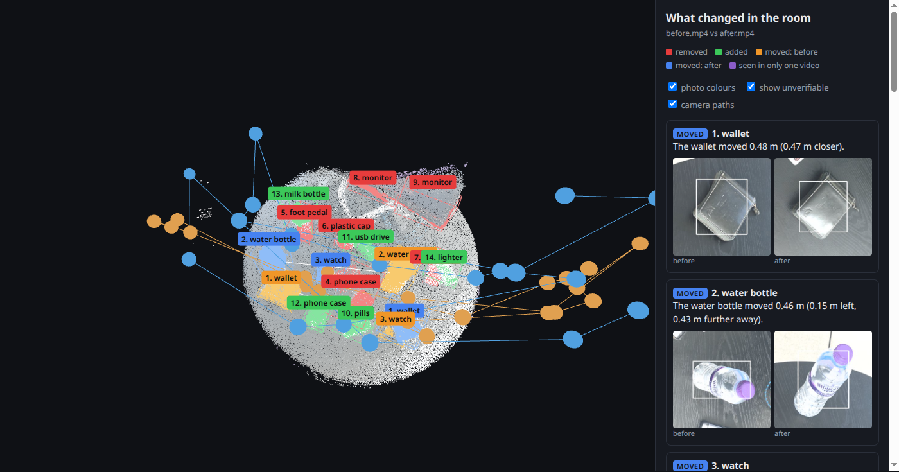
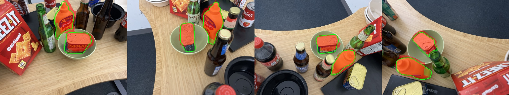
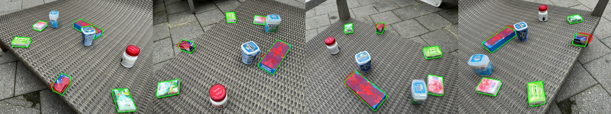

# Noticing Changes

My submission for Humanoid's "What Changed in the Room?" challenge.

A robot working in a real home or warehouse can't assume the world stays how it last saw it.
Chairs get pushed around, boxes appear in walkways and tools go missing, so it needs to notice
what's different since its last visit and tell that apart from simply looking from a new angle.

You give it two phone videos of the same space, one filmed before and one after you moved, added
or removed some things. It builds a single 3D scene out of both videos and tells you what changed,
where it is, and how far it moved. For example:

> The water bottle moved 0.46 m (0.16 m left, 0.43 m further away).

It works on a room, a corner of a room, a desk or a table. Along with the sentences you get an
interactive 3D viewer, before/after crops of every change and a JSON file with positions and sizes
in metres. A run takes 1 to 2 minutes on my laptop GPU (8 GB), and most of that is decoding 4K video.

Interactive 3D viewers (drag to rotate, scroll to zoom, click a change to fly to it):
[my table](https://hmmnice.github.io/noticing-changes/results/table2_obj/viewer.html),
[my table, geometry only](https://hmmnice.github.io/noticing-changes/results/table2/viewer.html),
[Desk](https://hmmnice.github.io/noticing-changes/results/3dgscd/Desk/viewer.html),
[Mustard](https://hmmnice.github.io/noticing-changes/results/3dgscd/Mustard/viewer.html),
[Bench](https://hmmnice.github.io/noticing-changes/results/3dgscd/Bench/viewer.html)



In the viewer, orange is where an object was and blue is where it is now. Red and green are things
that were removed or added. The dots and lines are the camera paths of the two videos.

## Running it

You need Linux, an NVIDIA GPU with at least 8 GB and Python 3.10 to 3.12.

```bash
./setup.sh
.venv/bin/python changes.py examples/table2/before.mp4 examples/table2/after.mp4 --out results/try
```

`setup.sh` makes a virtual environment and installs everything. The model weights download the
first time you run it. Add `--objects 1` to the second command to also look for flat objects (more
on that below). The inputs can be videos or folders of images, and everything gets written to the
`--out` folder:

| file | what's in it |
|---|---|
| `viewer.html` | the 3D viewer, a single file you can open in any browser |
| `report.md` | one sentence per change |
| `changes.json` | type, name, 3D centre and size in metres, how far it moved |
| `crops/` | a before and after picture of every change |

## How it works

First I pick the 20 sharpest frames from each video. Then all 40 frames go through
[Depth Anything 3](https://github.com/ByteDance-Seed/Depth-Anything-3) in one pass, which gives a
depth map and a camera position for every frame. Because both videos are reconstructed together,
the parts of the room that didn't change line them up automatically, so I never had to register
the two recordings against each other. A second model (DA3-Metric) gives the scale in metres, and
I fit a plane with RANSAC to find the floor or table top so that "up" and "left" mean something.

The main idea is a visibility check. For every 3D point from the before video, I look at it from
each camera in the after video and ask what that camera sees along the same line of sight:

| what the after camera sees | what it means |
|---|---|
| a surface at the same depth | the point is still there |
| something further away, behind the point | the point is gone |
| something closer, in front of the point | it's hidden, so no evidence either way |
| nothing (out of frame, or bad depth) | not observed, no evidence |

Running the same check the other way round finds what's new. This is what stops it calling
something "removed" just because the second video happened to point somewhere else, which was the
main thing the challenge asked for.

Points that changed get grouped into objects on a voxel grid. Weaker evidence is only kept if it
touches strong evidence (the same trick Canny edge detection uses), and every threshold scales
with how far away the scene is, so the same settings work for a room and for a desk.

To name each object I crop it out of the frame where it's most visible, draw a box around it and
ask a small vision-language model ([Qwen3-VL-2B](https://huggingface.co/Qwen/Qwen3-VL-2B-Instruct))
what it is. A "removed" object and an "added" object are joined into one "moved" object when their
CLIP image features are each other's best match (similarity of at least 0.7) and their names share
a real word, so "mustard bottle" and "french's mustard" match but "black monitor" and "black
wallet" don't.

The geometry always decides whether and where something changed. The names only describe it, so a
bad name can never create a change that isn't there.

### Flat objects (`--objects 1`)

The visibility check has one big blind spot. If a watch lying flat on a table moves, the spot where
it was is still "table, at about the same height", so the geometry sees nothing. For these cases
there's an optional second check. [Segment Anything](https://huggingface.co/facebook/sam-vit-base)
outlines every object in every frame, I put each outline into 3D using the depth I already have,
and then look at that same spot from the other video's cameras (only the ones that can actually see
it). If the crop from the other video looks different in CLIP from several angles, for example a
watch before and bare table after, the object gets marked as changed. It's off by default because
it also flags some things that didn't move, and it takes about 3 times as long.

## Results

### My table

I filmed my table twice with my phone in 4K and moved seven things in between: two wallets, a
watch, an SSD, a strip of medicine, a water bottle and a jar of mayonnaise. The input videos are in
`examples/table2/`, and the outputs are in `results/table2/` (default) and `results/table2_obj/`
(with `--objects 1`).

[](https://hmmnice.github.io/noticing-changes/results/table2_obj/viewer.html)

Click the picture to open it in 3D.

| what I changed | default | with `--objects 1` |
|---|---|---|
| wallet | found the new spot only ("a wallet appeared") | "the wallet moved 0.48 m" |
| watch | missed | "the watch moved 0.36 m" |
| water bottle | "the water bottle moved 0.46 m" | "the water bottle moved 0.46 m" |
| SSD | missed | found both spots ("foot pedal" removed, "usb drive" appeared) but didn't link them |
| card holder (second wallet) | missed | found both spots ("phone case") but didn't link them |
| mayonnaise | found the new spot only, called it "light yogurt" | found both spots ("plastic cap", "milk bottle") but didn't link them |
| medicine | missed | "pills appeared" (new spot) |
| total found | 3 of 7 | 7 of 7, 3 of them as a proper "moved" |
| false alarms | 2 (edge of my monitor) | 4 (monitor edge twice, and a power bank I didn't touch) |
| time | about 2 min | about 5 min |

Everything the default missed is flat or small. The object check finds all of it, but you pay for
it with a couple of extra false alarms and some strange names.

The videos in `examples/` are 1080p copies because the 4K originals are over GitHub's 100 MB file
limit. The results above came from the originals. If you rerun on the copies you'll get slightly
different detections, because re-encoding changes which frames count as the sharpest and the rest
follows from that.

### Public benchmark (3DGS-CD)

I also wanted an actual number, so I ran it on the [3DGS-CD dataset](https://github.com/520xyxyzq/3DGS-CD)
(Lu et al., RA-L 2025). It has real iPhone photos of scenes before and after objects were moved,
plus hand-made masks of what changed in a few held-out "after" photos. `eval_3dgscd.py` gives my
system 20 before images and 4 after images. The held-out photos are only used to get their camera
positions, never for detection. Then I project whatever was detected into those photos and compare
with the masks.

To rerun it, download the scenes from the
[dataset's Google Drive](https://drive.google.com/drive/folders/1OPUu643bkbAoryASNMi8_iDJGnypotc0)
into `data/3dgscd/<Scene>/` (you only need `rgb/`, `rgb_new/` and `masks_gt/`) and run:

```bash
.venv/bin/python eval_3dgscd.py data/3dgscd/Mustard data/3dgscd/Desk data/3dgscd/Bench
.venv/bin/python eval_3dgscd.py data/3dgscd/Mustard data/3dgscd/Desk data/3dgscd/Bench --objects=1
```

| scene | precision | recall | IoU | IoU with `--objects 1` | paper's IoU | paper's 2D baseline (MTP) |
|---|---|---|---|---|---|---|
| Mustard | 0.89 | 0.96 | 0.86 | 0.51 | 0.96 | 0.23 |
| Desk | 0.85 | 0.87 | 0.75 | 0.75 | 0.95 | 0.34 |
| Bench | 0.87 | 0.34 | 0.33 | 0.55 | 0.93 | 0.81 |

This isn't a fair fight with the paper. They train a Gaussian Splatting model on all 150 to 220
before images of each scene first, which takes minutes and isn't counted in their timing. I use 20
frames, no training, and it takes about 30 seconds.



Desk, held-out views. Green outline is the ground truth, red is what I detected.

On Mustard and Desk the moved objects are found and correctly joined up as "moved" (0.2 to 0.3 m),
and the masks line up well. There are still a few small false alarms, and which ones show up
depends on the exact frames. Bench is where geometry alone falls over. Most of the things that
moved are gum packets 1 to 2 cm thick on a woven sun lounger, so it finds where they were but
mostly not where they went, and recall is 0.34. Turning on `--objects 1` takes Bench recall to
0.96 (IoU 0.33 to 0.55), but on Mustard the extra false alarms cut precision roughly in half,
which is why it's not the default.



As a sanity check I also ran the same video as both "before" and "after". 99.1% of points came out
unchanged, and the only thing it flagged was a robot doing a backflip in the clip, which really
was moving.

## Things that didn't work

My first idea for flat objects was to compare small DINOv2 image patches at each 3D point between
the two videos. It made everything worse (Desk went from 0.75 to 0.63, Mustard from 0.86 to 0.74,
Bench didn't move), because the same surface seen from two angles gave surprisingly different
features. It's still in the code behind `--app-pct` but off. Comparing whole objects instead of
patches is what ended up working.

Naming objects by picking the closest word from a list of about 150 with CLIP gave me "hammer" for
my wallet and "chewing gum pack" for the mayonnaise. Switching to the vision-language model fixed
most of that, and having real names also let me throw out a wrong "moved" pair (my monitor edge
matched with the wallet).

Matching with CLIP on crops that included the surrounding table didn't work either, because every
pair scored somewhere between 0.65 and 0.88. Greying out everything except the object itself made
the right pairs stand out (about 0.9 against 0.6 to 0.7).

The paper says its masks cover both where objects went and where they came from, so at first I
scored both. The released masks only mark where things ended up (I checked by overlaying them), so
the scoring only uses that.

## Design choices

I went with a feed-forward model for the 3D instead of COLMAP plus per-scene training. It's quick,
it doesn't need tuning per scene and it lines the two videos up for free. The downside is that only
about 40 frames fit on an 8 GB GPU and the depth is less precise than a trained model, which
explains most of the gap to the paper.

I decide change in 3D with the visibility check instead of comparing images, because that's what
lets it tell "not seen" apart from "gone". Appearance is only used as an optional second opinion,
so by default the system rarely invents changes.

The whole thing is one Python file (`changes.py`, about 800 lines) plus one HTML file for the
viewer. Nothing is trained.

## Limitations and what I'd do next

Flat objects only get found with `--objects 1`, and that costs precision and time. Only about 40
frames fit on my GPU, so a lot of each video goes unused. Results move around a bit depending on
which frames are picked. Anything moving during a video (a person, a pet) shows up as a change.

The next step I'd take is the approach semantic mapping systems like ConceptGraphs and Hydra use:
segment objects first, merge them across frames into proper 3D objects, and then compare object
to object. My object check already compares per object, but it still feeds points into the
clustering. Merging them into persistent objects first should cut the false alarms and link both
ends of a move more often.

## Conclusions

The thing that worked best was reconstructing both videos together. I'd planned a separate step to
align the two recordings, and it turned out I didn't need one. The visibility check also did what I
hoped. On a static scene it flags almost nothing, and on the benchmark it's right 85 to 89% of the
time when it says something changed. Making the names and the geometry check each other was worth
it too, because it removed wrong "moved" pairs that image similarity alone accepted.

What didn't work was relying on geometry alone. Anything flat, like a watch, a wallet or a strip of
pills, barely changes the depth when it moves, so the default found only 3 of my 7 changes. The
object check fixes that (7 of 7) but brings more false alarms with it. Some names are still off
("foot pedal" for an SSD), and the two ends of a move are often reported separately when the crops
don't look similar enough.

A few things surprised me. The crop mattered more than the model: with the table left in, every
pair looked alike, and greying it out fixed matching straight away. I expected image features of
the same surface to be stable across viewpoints, and they really weren't. Re-encoding the video
was enough to change the results. And the benchmark masks didn't match how the paper describes
them, which I only noticed by overlaying them on the photos.

## Credits

Depth Anything 3 (ByteDance Seed), Qwen3-VL (Alibaba Qwen), CLIP (OpenAI), Segment Anything (Meta)
and the 3DGS-CD dataset (Lu, Ye, Leonard).
